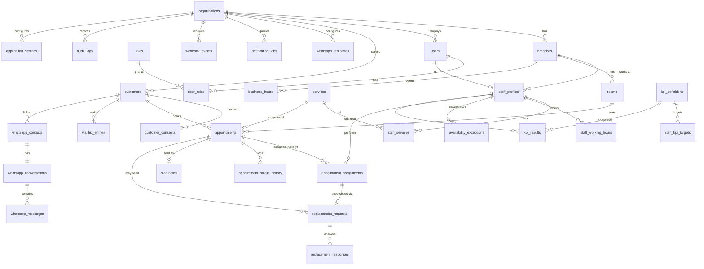

# Data model

Source of truth: `supabase/migrations/*.sql` (applied in filename order). All tenant tables carry `organisation_id`. Timestamps are `timestamptz` (stored UTC). Statuses are `text` + `CHECK` (portable, easy to extend). `created_at/updated_at` on mutable tables; `created_by/updated_by` where a person acts; row-level changes are additionally captured by the audit trigger.

## Entity relationship (simplified)

## Tables (by migration)

**001 core**: `organisations`, `branches`, `roles` (customer, masseuse, manager, administrator), `users`, `user_roles`, `staff_profiles`, `customers`, `customer_consents`, `services`, `staff_services`, `rooms`, `resources`, `business_hours`, `staff_working_hours`, `availability_exceptions`.
**002 booking**: `audit_logs`, `appointment_status_transitions`, `appointments`, `appointment_assignments`, `appointment_status_history`, `slot_holds`, `waitlist_entries`, `idempotency_keys`.
**003 replacement & KPI**: `replacement_requests`, `replacement_responses`, `kpi_definitions`, `staff_kpi_targets`, `kpi_results`.
**004 WhatsApp & ops**: `whatsapp_contacts`, `whatsapp_conversations`, `whatsapp_templates`, `whatsapp_messages`, `webhook_events`, `notification_jobs`, `application_settings`, `sessions`, `rate_limits`, `booking_access_tokens`, `booking_otps`, `data_requests` + audit triggers.
**005 RLS**: roles `booking_system`, `booking_staff`, helper functions, policies, column grants, admin views, `auth_find_user`/`auth_resolve_session`.

## Key design points

- **Appointments** snapshot duration buffers, `counts_toward_kpi` and price from the service at booking time; later service edits never rewrite history or KPI hours. Fields `start_at`, `end_at`, `service_id`, `room_id`, `customer_id` are immutable (trigger `BK006`).
- **`occupied`** (`tstzrange`) = service interval widened by the buffers; set by trigger; the exclusion constraints use it.
- **Assignments** keep history: `active` (at most one per appointment, partial unique index), `superseded` (replaced), `released` (appointment ended without completing). `origin`: `booking | manager_reassign | replacement`. `override_rules`/`override_reason` record manager overrides (CHECK: a reason of ≥ 5 characters whenever an override is present). `acknowledged_at` drives the masseuse's "new" indicator.
- **Customers**: one row per phone number (partial unique index excludes anonymised rows). `operational_note` is limited to 500 characters and is for operational remarks only. **No health or consultation notes are modelled.** No gender/age/ethnicity of customers or staff is stored.
- **Consents** are append-only records per purpose (`service_booking`, `whatsapp_messaging`, `marketing`) with notice version and channel. The effective consent is the latest row.
- **Availability exceptions** use a half-open `tstzrange`; kinds `break | leave | blocked | training | internal | closure`; staff requests start `pending` and have no effect until a manager approves (approval fails with `BK007` if bookings overlap).
- **Working hours** changes by staff are `pending` batches (`batch_id`); approval supersedes the previous approved set.
- **Replacement requests** snapshot `starts_at` and `service_name` so the nominee can decide without being able to read the appointment or customer (RLS).
- **Soft deletion/archival**: `staff_profiles.archived_at`, `customers.archived_at/anonymised_at`. Appointments are never deleted. Anonymisation removes identifiers but keeps bookings for KPI integrity.
- **Concurrency/versioning**: `appointments.version` increments on every update; `replacement_requests.version`; row locks (`SELECT … FOR UPDATE`) in services.
- **Idempotency**: `idempotency_keys` (scope, key, request hash, stored response); `appointments.idempotency_key` unique per organisation; `webhook_events(provider, event_key)` unique; `notification_jobs(organisation_id, dedupe_key)` unique.

## Index strategy

| Index                                                                                                                      | Purpose                                          |
| -------------------------------------------------------------------------------------------------------------------------- | ------------------------------------------------ |
| GiST `assignments_staff_no_overlap (staff_id, occupied) WHERE status='active'`                                             | conflict prevention **and** availability lookups |
| GiST `appointments_room_no_overlap (room_id, occupied)`                                                                    | room conflicts                                   |
| GiST `availability_exceptions (staff_id, period) WHERE status='approved'` and `(branch_id, period) WHERE staff_id IS NULL` | leave/closure checks                             |
| `appointments (organisation_id, branch_id, start_at)`                                                                      | calendar range queries                           |
| `appointments (customer_id, start_at DESC)`                                                                                | customer bookings, first-visit test              |
| partial `appointments (hold_expires_at) WHERE status='slot_held'`                                                          | hold sweeper                                     |
| `appointments (organisation_id, status, start_at)`                                                                         | dashboards                                       |
| unique partial `assignments_one_active_per_appointment`, `replacement_open_uq`                                             | invariants                                       |
| partial `notification_jobs (next_attempt_at) WHERE status IN ('pending','failed')`                                         | outbox polling                                   |
| partial `webhook_events (status, received_at)`                                                                             | retry polling                                    |
| `audit_logs (organisation_id, entity_type, entity_id, occurred_at DESC)`                                                   | audit lookups                                    |
| `customers` unique `(organisation_id, phone_e164) WHERE anonymised_at IS NULL`                                             | identity                                         |

Expected volume (a handful of staff, hundreds of bookings/month) is far below any scaling limit; indexes are chosen for correctness first.

## Row-level security

See migration 005 and `tests/security.integration.test.ts`. Summary:

| Table group                                                                     | booking_staff: manager | masseuse                                                                  | administrator                                                                  |
| ------------------------------------------------------------------------------- | ---------------------- | ------------------------------------------------------------------------- | ------------------------------------------------------------------------------ |
| appointments, assignments, history                                              | all                    | only appointments she is/was assigned to                                  | none                                                                           |
| customers, consents                                                             | all                    | only customers on her appointments (first name + masked phone in the app) | none                                                                           |
| availability, working hours                                                     | all                    | own rows; may insert `pending` only                                       | none                                                                           |
| replacement requests                                                            | all                    | as requester/nominee                                                      | none                                                                           |
| KPI targets/results                                                             | all                    | own and defaults                                                          | none                                                                           |
| WhatsApp contacts/conversations/messages, webhook payloads, notification params | all                    | none                                                                      | none (status-only views `v_webhook_events_admin`, `v_notification_jobs_admin`) |
| audit_logs                                                                      | read                   | none                                                                      | read                                                                           |
| settings, templates                                                             | read/write             | read settings                                                             | write settings/templates                                                       |
| users                                                                           | all (no password hash) | self                                                                      | all (no password hash)                                                         |

`booking_system` is scoped to the organisation (`organisation_id = app.org_id`) on every table. `audit_logs` cannot be updated or deleted by anyone (trigger `BK009`).

## Retention configuration

`application_settings.retention` (editable in Settings): `customerInactiveMonths` (36), `whatsappMessageDays` (90), `webhookEventDays` (30), `auditLogMonths` (84, informational: see below), `expiredHoldDays` (7, informational). The cron tick runs `runRetention` once a day (~03:00 KL): deletes processed webhook events, clears WhatsApp message bodies, purges idempotency keys, rate limits, expired sessions/tokens/OTPs and finished jobs, and anonymises customers inactive past the threshold. **Audit log purging is intentionally not automated** (append-only table); see `backup-restore.md` for the controlled DBA procedure.

## Time zones

All instants are UTC. Business logic that depends on a "day" (working hours, business hours, KPI periods, reminders) uses the **branch** time zone (`branches.timezone`, default `Asia/Kuala_Lumpur`): in SQL via `AT TIME ZONE`, in TypeScript via Luxon with an explicit zone. Tests cover midnight and weekday boundaries (a Sunday 11:00 KL booking is 03:00 UTC Sunday; KL midnight is 16:00 UTC the previous day).
